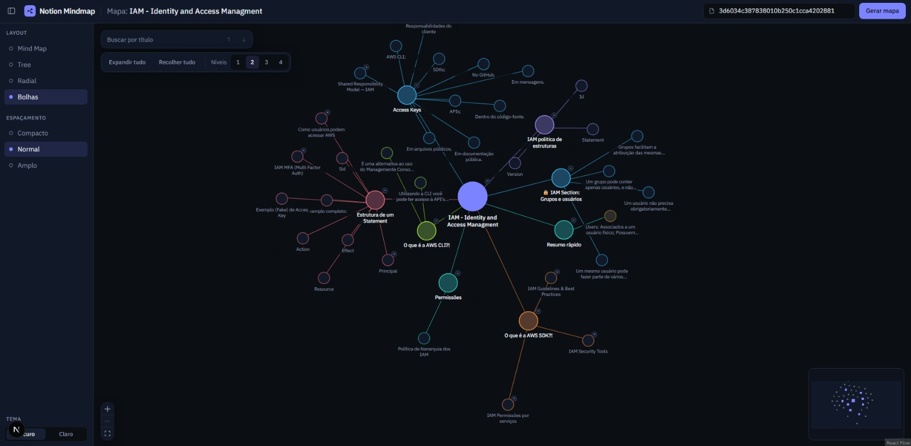
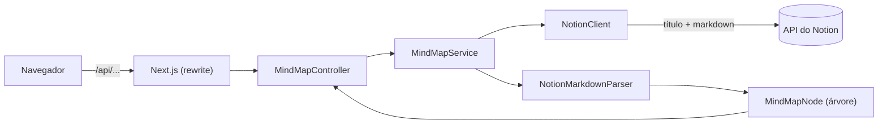

# Notion Mindmap

Cole o ID de uma página do Notion e veja ela virar um mapa mental que dá pra navegar. Comecei pra estudar: minhas anotações de AWS ficam em páginas longas, e um mapa deixa a estrutura visível de uma vez.



**Demo:** mindmap-notion.vercel.app

## O que já faz

- Lê uma página do Notion pela API oficial e converte o conteúdo numa árvore própria: títulos, listas, callouts, colunas, blocos de código e citações.
- Desenha a árvore com React Flow e layout automático (dagre).
- Ramos começam recolhidos, com contador de itens escondidos, cor por ramo, busca por título e painel com o texto completo de cada nó.
- Responde em cerca de 1,8 s numa página longa.

## Como funciona



O frontend só conversa com o meu backend. O backend é o único que conhece o Notion: ele busca o conteúdo, o parser transforma em `MindMapNode` e o front recebe um JSON simples, sem nada do formato do Notion. Se um dia eu aceitar PDF ou markdown local, entra um parser novo que devolve o mesmo `MindMapNode`, e o front nem percebe.

## Decisões que valem explicar

**Árvore própria em vez de repassar o JSON do Notion.** O Notion entrega uma lista reta de blocos. O mapa precisa de pai e filho. O parser usa uma pilha com o caminho de títulos atual: um título novo desempilha os de nível igual ou maior e vira filho do que sobrou. Parágrafos, código e citações viram a descrição do nó, e só títulos, itens de lista e callouts viram caixinhas, senão o mapa fica ilegível.

**Markdown em vez de blocos: de 11,2 s para 1,8 s.** A primeira versão lia os blocos um a um. Os filhos de callouts, colunas e listas aninhadas não vêm junto, então cada um exige uma chamada nova, e o Notion limita a cerca de 3 requisições por segundo. Numa página real minha, deu 11,2 s. O endpoint de markdown devolve a página inteira numa chamada: cerca de 0,5 s no Notion e 1,8 s na resposta completa do backend. O custo foi escrever um parser de markdown com as extensões do Notion (colunas e callouts viram tags) e perder os ids de bloco. O parser de blocos continua no código como plano B.

**Ids derivados do caminho.** Sem os ids de bloco do Notion, o id de cada nó é calculado a partir do caminho dele (pai, tipo, título e ocorrência entre irmãos). O mesmo conteúdo gera os mesmos ids, o que vai permitir preservar cores e posições quando o mapa for atualizado. O limite: renomear um título muda o id dele e o dos filhos.

As outras decisões ficam em [docs/DECISIONS.md](docs/DECISIONS.md).

## Stack

- **Backend:** Java 21, Spring Boot, Spring Security, Spring Session JDBC, Flyway, RestClient, Jackson, JUnit
- **Frontend:** Next.js, TypeScript, Tailwind, React Flow, dagre
- **Infra local:** Docker Compose (Postgres)
- **CI:** GitHub Actions (testes do backend, lint e build do front, gitleaks)

## Rodando localmente

Precisa de Java 21, Maven, Node 20 ou mais novo e Docker.

1. Suba o Postgres: `docker compose up -d`. Ele guarda as sessões e os tokens.
2. Gere a chave que criptografa os tokens (sem ela o backend não sobe) e defina as variáveis de ambiente. O modelo, com explicação de cada uma, está em [`.env.example`](.env.example):
    - bash: `export TOKEN_ENCRYPTION_KEY="$(openssl rand -base64 32)"`
    - PowerShell: `$b = New-Object byte[] 32; [Security.Cryptography.RandomNumberGenerator]::Create().GetBytes($b); $env:TOKEN_ENCRYPTION_KEY = [Convert]::ToBase64String($b)`
3. Escolha como o backend lê o Notion:
    - **Login com o Notion (OAuth2).** Crie uma integração **pública** em [notion.so/profile/integrations](https://www.notion.so/profile/integrations), cadastre o Redirect URI `http://localhost:3000/api/auth/notion/callback` e defina `NOTION_CLIENT_ID` e `NOTION_CLIENT_SECRET`. Cada pessoa entra com a própria conta e o token dela fica criptografado no banco.
    - **Token pessoal, só para desenvolvimento.** Crie uma integração interna, conecte a página pelo menu `...` > Conexões e defina `NOTION_TOKEN` e `APP_DEV_TOKEN_FALLBACK=true`. Sem usuário logado, o backend usa esse token. Em produção isso fica desligado.
4. Backend: `cd backend/mindmap-api` e `mvn spring-boot:run` (porta 8080). O Flyway cria as tabelas na primeira subida.
5. Frontend: `cd frontend`, `npm install` e `npm run dev`, depois abra `localhost:3000`.

A tela ainda não tem o botão "Entrar com o Notion". Enquanto isso, para ver o mapa funcionando localmente, use o token pessoal do passo 3. Para testar o login pelo navegador, abra `localhost:3000/api/auth/notion/login`.

Pra copiar o ID de uma página, pegue os 32 caracteres no final da URL dela.

Testes: `mvn verify` no backend (não precisa de banco nem de variáveis), `npm run lint` e `npm run build` no frontend.

## Estrutura

```
backend/mindmap-api   API em Spring Boot
frontend              Next.js
docs                  decisões e imagens
docker-compose.yml    Postgres local
```

## O que ainda não existe

- Tela de login no frontend. O backend já faz o login com o Notion (OAuth2) e a sessão; falta o botão "Entrar", mostrar quem está logado (`/api/me`), o logout (com o cabeçalho `X-XSRF-TOKEN`) e o aviso quando a API responde 401.
- Salvar mapas no Postgres (JSONB), junto com cores e posições editadas.
- Botão "atualizar mapa" quando a página muda no Notion.
- Camada de IA opcional pra reorganizar o conteúdo.

## Segurança

O conteúdo das páginas é tratado como dado não confiável: o front renderiza tudo como texto, sem HTML cru. O login com o Notion usa OAuth2 com sessão no servidor: o navegador só recebe um cookie `HttpOnly`, e o token do Notion de cada pessoa fica só no backend, criptografado no banco (AES-GCM, chave em variável de ambiente), nunca no front nem no log. O ID da página é validado no front e de novo no backend. O CI roda o gitleaks no histórico inteiro do repositório.
