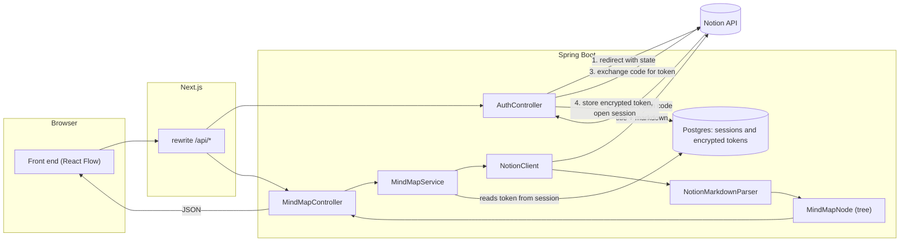

<a id="readme-top"></a>

<br />
<div align="center">

  <h1 align="center">Notion Mindmap</h1>

  <p align="center">
    <b>Turn any Notion page into an interactive mind map.</b>
    <br />
    Sign in with Notion, pick a page, and see its whole structure at once. Spring Boot on the back end, Next.js and React Flow on the front end.
    <br />
  </p>

  <p align="center">
    <a href="https://github.com/BrunoCaffz/mindmap-api/actions/workflows/ci.yml"></a>
    <a href="./LICENSE"></a>
    
    
    
  </p>

  <p align="center">
    <a href="https://mindmap-notion.vercel.app">Live Demo</a>
    ·
    <a href="https://github.com/BrunoCaffz/mindmap-api/issues/new?labels=bug">Report Bug</a>
    ·
    <a href="https://github.com/BrunoCaffz/mindmap-api/issues/new?labels=enhancement">Request Feature</a>
    ·
    <a href="./docs/DECISIONS.md">Design Decisions</a>
    ·
    <a href="./docs/DEPLOY.md">Deploy Guide</a>
  </p>
</div>

> [!NOTE]
> The live demo runs in **localhost**: see how to run in
> [Getting Started](#getting-started).

<div align="center">

https://github.com/user-attachments/assets/14655ffe-59f4-4700-b9b6-24d1248062a8

</div>


## What It Is

Long Notion pages are great for writing and hard for seeing. A study guide, a spec, a set of meeting
notes: the structure is there, but you scroll through it one screen at a time.

**Notion Mindmap reads a page and draws its structure.** Headings, lists, callouts, columns, code
blocks and quotes become a tree of nodes you can fold, search, re-layout and export. It started as a
study tool: my AWS notes live in long Notion pages, and a map shows the whole outline in one view.

Each person authorizes their own workspace through Notion OAuth, and the app only reads the pages
they choose to share.

## Features

- **Notion OAuth2 login.** Every user connects their own workspace and shares only the pages they pick.
- **Page to map.** Paste a page ID and the content becomes a tree with headings, lists, callouts, columns, code blocks and quotes.
- **Four layouts and three spacings.** Mind map, tree, radial and bubbles.
- **Easy to navigate.** Branches start collapsed with a hidden-items counter, color per branch, search by title.
- **Detail panel.** Full text of any node in a side panel.
- **Export.** Save the map as PNG or SVG.
- **Light and dark themes.**
- **Session handling.** Login screen, user and workspace in the header, logout, expired-session notice.
- **Demo mode.** The same front end with an embedded sample map, no back end and no login.
- **Clear error messages** for invalid page IDs, pages without access, Notion rate limits and network failures.

## How It Works



**Reading flow.** The front end calls `/api/...` on its own origin and Next.js forwards the request
to the back end. `MindMapService` asks `NotionClient` for the page title and markdown,
`NotionMarkdownParser` builds a tree of `MindMapNode`, and the controller returns plain JSON. Only
`NotionClient` talks to Notion, so the rest of the system never sees Notion's format.

**Login flow.** `GET /api/auth/notion/login` stores a random `state` in the session and redirects to
Notion. On the callback the back end checks the `state`, exchanges the `code` for a token, stores the
token encrypted in Postgres and opens the session. The browser only ever receives the session cookie.

## Tech Stack

| Layer | Tools |
|---|---|
| **Back end** | Java 21, Spring Boot, Spring Security, Spring Session JDBC, Flyway, Postgres, RestClient, Jackson, JUnit |
| **Front end** | Next.js, React, TypeScript, Tailwind, React Flow, dagre (tree layouts), d3-force (bubble layout), html-to-image (export) |
| **Infra** | Docker, Docker Compose, Caddy (automatic HTTPS), GitHub Actions, gitleaks, Vercel (demo) |

## Security and Design Decisions

The full record, with context and trade-offs for each choice, is in
[docs/DECISIONS.md](docs/DECISIONS.md). The short version:

- **Server-side sessions, not JWT.** The browser gets an `HttpOnly`, `SameSite=Lax` cookie, `Secure` in production. Sessions live in Postgres and expire after 8 hours of inactivity, so logout and revocation actually work.
- **CSRF protection on.** The token travels in the `XSRF-TOKEN` cookie and comes back in the `X-XSRF-TOKEN` header. A POST without it gets a 403.
- **Notion tokens encrypted at rest.** AES-256-GCM with a random nonce per record and user and workspace as authenticated data. The key comes from `TOKEN_ENCRYPTION_KEY` and the app refuses to start without it. There is no key rotation yet.
- **The token never reaches the front end or the logs.** `GET /api/me` returns only the user and workspace names.
- **OAuth callback defenses.** A random, single-use `state`, compared in constant time, plus a session ID change before authenticating (against session fixation).
- **Same origin, no CORS.** The front end only talks to the back end through the Next.js rewrite.
- **Secrets only through environment variables.** The template is in [`.env.example`](.env.example), and CI runs gitleaks over the full history.
- **Notion content is untrusted data.** The front end renders everything as text, never raw HTML.
- **Markdown instead of blocks.** One Notion call instead of one per block with children: from 11.2 s down to 1.8 s on a real page.
- **Node IDs derived from the path.** The markdown endpoint has no block IDs. Trade-off: renaming a heading changes its ID and its children's.

## Getting Started

Requires Java 21, Maven, Node 20 or newer, and Docker.

1. **Database.** `docker compose up -d` starts Postgres on port 5433 (5432 is often taken by a local Postgres). It stores sessions and tokens.
2. **Notion integration.** At [notion.so/profile/integrations](https://www.notion.so/profile/integrations), create a **public** integration and register the redirect URI `http://localhost:3000/api/auth/notion/callback`. Copy the client ID and client secret.
3. **Environment variables.** Spring Boot does not read a `.env` file by itself, so set the variables in your terminal before starting the back end. [`.env.example`](.env.example) explains each one. The required ones are `NOTION_CLIENT_ID`, `NOTION_CLIENT_SECRET` and `TOKEN_ENCRYPTION_KEY`. To generate the key:
    - bash: `export TOKEN_ENCRYPTION_KEY="$(openssl rand -base64 32)"`
    - PowerShell: `$b = New-Object byte[] 32; [Security.Cryptography.RandomNumberGenerator]::Create().GetBytes($b); $env:TOKEN_ENCRYPTION_KEY = [Convert]::ToBase64String($b)`
4. **Back end.** `cd backend/mindmap-api` then `mvn spring-boot:run` (port 8080). Flyway creates the tables on first start.
5. **Front end.** `cd frontend`, `npm install`, `npm run dev`, then open `localhost:3000` and sign in with Notion. Grant access to the page you want to map during authorization. The page ID is the 32 characters at the end of its URL.

**Demo mode.** No back end, no database, no Notion needed: `cd frontend`, then
`NEXT_PUBLIC_DEMO_MODE=true npm run dev` (PowerShell: `$env:NEXT_PUBLIC_DEMO_MODE="true"; npm run dev`).
This is the same build that runs on Vercel.

**Without OAuth, development only.** Create an internal integration, connect your page through the `...` menu > Connections, then set `NOTION_TOKEN` and `APP_DEV_TOKEN_FALLBACK=true` on the back end and `NEXT_PUBLIC_DEV_TOKEN_FALLBACK=true` on the front end. With no signed-in user, the back end uses that token. It is off by default and must never be enabled in production.

## Tests and CI

GitHub Actions runs on every push to `main` and on every pull request:

- **Back end:** `mvn verify`. Unit tests (parsers, token encryption, services) and slice tests with `@WebMvcTest` and the real security chain (login, `/api/me`, map endpoint, error handling). No database or environment variables needed.
- **Front end:** `npm ci`, `npm run lint` and `npm run build` with `NEXT_PUBLIC_DEMO_MODE=true`.
- **Secrets:** gitleaks over the full history.

Known limit: the full-context test (`contextLoads`) is disabled because it needs Postgres. Flyway, the session tables and encrypted storage were verified by hand against a throwaway database. Testcontainers is the next step to bring that into CI.

## Deployment

The repository ships a [`Dockerfile`](backend/mindmap-api/Dockerfile) for the API,
[`docker-compose.prod.yml`](docker-compose.prod.yml) (Postgres, API and Caddy) and a
[`Caddyfile`](Caddyfile) with automatic HTTPS, meant for a single VPS with the front end on Vercel.
Step-by-step instructions and backups are in [docs/DEPLOY.md](docs/DEPLOY.md).

The Dockerfile and the production compose file were tested locally: image build, Flyway migrations on
an empty database, and API startup. Caddy and HTTPS have not been validated on a real server yet.

The full app is not hosted 24/7 because of cost. What is online is the
[demo on Vercel](https://mindmap-notion.vercel.app), which runs without a back end.

## Project Structure

```
backend/mindmap-api      Spring Boot API
frontend                 Next.js app
docs                     decisions, deploy guide, images
docker-compose.yml       local Postgres
docker-compose.prod.yml  production (Postgres, API, Caddy)
```

## Roadmap

- [x] Notion OAuth login with server-side sessions and encrypted tokens.
- [x] Interactive map with four layouts, search and collapsible branches.
- [x] PNG and SVG export.
- [x] CI with tests, lint, build and secret scanning.
- [x] Docker and Compose files for production, tested locally.
- [ ] Save maps in Postgres (JSONB), including edited colors and positions.
- [ ] Sync button to refresh a map when the Notion page changes.
- [ ] Notion pagination: the main path uses the markdown endpoint, which returns the page in one call and has no cursor. When a page is too large, Notion marks the response as truncated and the back end currently only logs a warning. The block-based fallback already follows `has_more` and `next_cursor`.
- [ ] Testcontainers in CI.
- [ ] Validate Caddy and HTTPS on a real server.
- [ ] Optional AI layer to reorganize content.

## Contributing

Issues and suggestions are welcome. For anything bigger than a small fix, please open an issue first
so we can talk about the direction. Bug reports with clear reproduction steps help the most.

## License

Distributed under the MIT License. See [`LICENSE`](LICENSE).

## Author

Made by [Bruno Caffz](https://github.com/BrunoCaffz).

<p align="right">(<a href="#readme-top">back to top</a>)</p>
