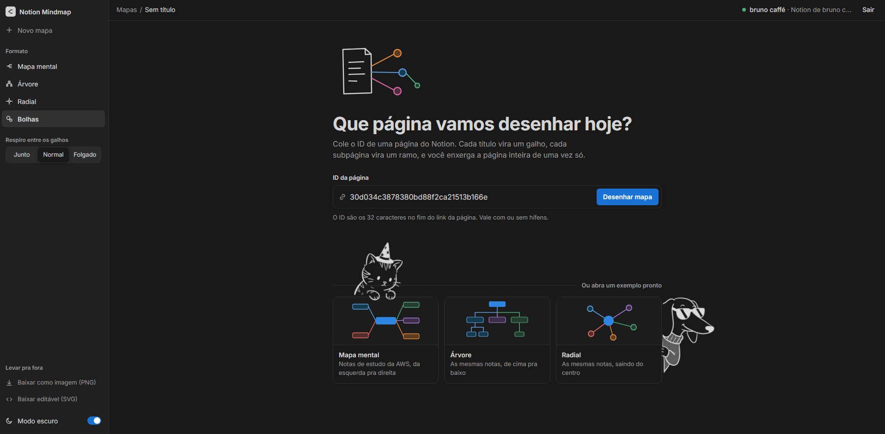
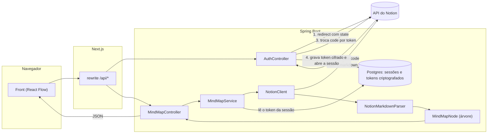

# Notion Mindmap

Webapp que transforma uma página do Notion em um mapa mental interativo. Spring Boot no backend, Next.js e React Flow no frontend.

[](https://github.com/BrunoCaffz/mindmap-api/actions/workflows/ci.yml)

**Demo:** [mindmap-notion.vercel.app](https://mindmap-notion.vercel.app). Abre na tela inicial e tem um mapa de exemplo fictício para explorar, sem login e sem backend.

<!-- TODO: adicionar a imagem docs/img/mapa.png (screenshot do mapa). Até lá, o link abaixo aparece quebrado. -->


## Demonstração em vídeo

<!-- TODO: substituir LINK_DO_VIDEO pela URL do vídeo de demonstração quando ele estiver gravado. -->
[Assistir à demonstração](LINK_DO_VIDEO)

## Por que existe

Comecei pra estudar: minhas anotações de AWS ficam em páginas longas do Notion, e um mapa mostra a estrutura inteira de uma vez.

## Funcionalidades

- Login com o Notion (OAuth2). Cada pessoa autoriza o próprio workspace e o app só lê as páginas que ela liberar.
- Gera o mapa a partir do ID de uma página. O conteúdo vira uma árvore própria com títulos, listas, callouts, colunas, blocos de código e citações.
- Quatro layouts (mapa mental, árvore, radial e bolhas) e três espaçamentos.
- Ramos recolhidos no início, com contador de itens escondidos, cor por ramo e busca por título.
- Painel com o texto completo de cada nó.
- Exportação do mapa em PNG e em SVG.
- Tema claro e escuro.
- Tela de login, nome do usuário e workspace no cabeçalho, logout e aviso de sessão expirada.
- Modo demo: o mesmo front, com um mapa de exemplo embutido, sem backend e sem login.
- Mensagens de erro específicas para ID inválido, página sem acesso, limite do Notion e falha de rede.

## Arquitetura



**Fluxo de leitura.** O front chama `/api/...` na própria origem e o Next repassa ao backend. O `MindMapService` pede ao `NotionClient` o título e o markdown da página, o `NotionMarkdownParser` monta a árvore de `MindMapNode` e o controller devolve um JSON simples. Só o `NotionClient` fala com o Notion. O resto do sistema nunca vê o formato dele.

**Fluxo de login.** `GET /api/auth/notion/login` guarda um `state` aleatório na sessão e redireciona para o Notion. No callback, o backend confere o `state`, troca o `code` pelo token, grava o token criptografado no Postgres e abre a sessão. O navegador recebe só o cookie de sessão. A cada leitura, o backend usa a sessão para achar o token da pessoa.

## Stack

**Backend:** Java 21, Spring Boot, Spring Security, Spring Session JDBC, Flyway, Postgres, RestClient, Jackson, JUnit.

**Frontend:** Next.js, React, TypeScript, Tailwind, React Flow, dagre (layouts em árvore), d3-force (layout em bolhas), html-to-image (exportação).

## Decisões de segurança e arquitetura

O registro completo, com contexto e custo de cada escolha, está em [docs/DECISIONS.md](docs/DECISIONS.md). O resumo:

- **Sessão no servidor, não JWT.** O navegador recebe um cookie `HttpOnly`, `SameSite=Lax` e `Secure` em produção. A sessão fica no Postgres e expira após 8 horas sem uso. Dá pra encerrar uma sessão de verdade (logout, token revogado).
- **CSRF ligado.** O token vai no cookie `XSRF-TOKEN` e volta no cabeçalho `X-XSRF-TOKEN`. Sem ele, o POST recebe 403.
- **Tokens do Notion cifrados em repouso.** AES-256-GCM, com nonce aleatório por registro e usuário e workspace como dado autenticado. A chave vem de `TOKEN_ENCRYPTION_KEY` e o app não sobe sem ela. Não há rotação de chave por enquanto.
- **O token nunca vai ao front nem aos logs.** `GET /api/me` devolve só o nome do usuário e do workspace.
- **Defesas no callback do OAuth.** `state` aleatório, de uso único, comparado em tempo constante, e troca do id da sessão antes de autenticar (contra session fixation).
- **Mesma origem, sem CORS.** O front só fala com o backend pelo rewrite do Next.
- **Segredos só por variável de ambiente.** O modelo está em [`.env.example`](.env.example). O CI roda o gitleaks no histórico inteiro.
- **Conteúdo do Notion é dado não confiável.** O front renderiza tudo como texto, sem HTML cru.
- **Markdown em vez de blocos.** Uma chamada ao Notion em vez de uma por bloco com filhos: de 11,2 s para 1,8 s numa página real.
- **Ids dos nós derivados do caminho.** O endpoint de markdown não traz ids de bloco. Limite: renomear um título muda o id dele e o dos filhos.

## Rodando localmente

Precisa de Java 21, Maven, Node 20 ou mais novo e Docker.

1. **Banco.** `docker compose up -d` sobe o Postgres na porta 5433 (a 5432 costuma estar ocupada por um Postgres local). Ele guarda as sessões e os tokens.
2. **Integração do Notion.** Em [notion.so/profile/integrations](https://www.notion.so/profile/integrations), crie uma integração **pública** e cadastre o Redirect URI `http://localhost:3000/api/auth/notion/callback`. Copie o client id e o client secret.
3. **Variáveis de ambiente.** O Spring Boot não lê arquivo `.env` sozinho: defina as variáveis no terminal antes de rodar o backend. O modelo, com a explicação de cada uma, está em [`.env.example`](.env.example). As obrigatórias são `NOTION_CLIENT_ID`, `NOTION_CLIENT_SECRET` e `TOKEN_ENCRYPTION_KEY`. Para gerar a chave:
    - bash: `export TOKEN_ENCRYPTION_KEY="$(openssl rand -base64 32)"`
    - PowerShell: `$b = New-Object byte[] 32; [Security.Cryptography.RandomNumberGenerator]::Create().GetBytes($b); $env:TOKEN_ENCRYPTION_KEY = [Convert]::ToBase64String($b)`
4. **Backend.** `cd backend/mindmap-api` e `mvn spring-boot:run` (porta 8080). O Flyway cria as tabelas na primeira subida.
5. **Frontend.** `cd frontend`, `npm install` e `npm run dev`, depois abra `localhost:3000` e entre com o Notion. No Notion, libere a página que quer mapear durante a autorização. O ID dela são os 32 caracteres no final da URL.

**Sem OAuth, só para desenvolvimento.** Crie uma integração interna, conecte a página pelo menu `...` > Conexões e defina `NOTION_TOKEN` e `APP_DEV_TOKEN_FALLBACK=true` no backend, e `NEXT_PUBLIC_DEV_TOKEN_FALLBACK=true` no front. Sem usuário logado, o backend usa esse token. O padrão é desligado.

**Modo demo.** Sem backend, sem banco e sem Notion: `cd frontend`, `NEXT_PUBLIC_DEMO_MODE=true npm run dev` (PowerShell: `$env:NEXT_PUBLIC_DEMO_MODE="true"; npm run dev`). É o mesmo build que roda na Vercel.

## Testes e CI

O GitHub Actions roda em todo push na `main` e em todo pull request:

- **Backend:** `mvn verify`. Testes unitários (parsers, criptografia dos tokens, serviços) e de fatia com `@WebMvcTest` e a cadeia de segurança real (login, `/api/me`, mapa, tratamento de erros). Não precisa de banco nem de variáveis.
- **Frontend:** `npm ci`, `npm run lint` e `npm run build` com `NEXT_PUBLIC_DEMO_MODE=true`.
- **Segredos:** gitleaks no histórico inteiro.

Limite conhecido: o teste de contexto completo (`contextLoads`) está desativado porque exige Postgres. Flyway, tabelas de sessão e criptografia gravada foram conferidos à mão com um banco descartável. Testcontainers é o próximo passo para trazer isso ao CI.

## Deploy

O repositório traz [`backend/mindmap-api/Dockerfile`](backend/mindmap-api/Dockerfile), [`docker-compose.prod.yml`](docker-compose.prod.yml) (Postgres, API e Caddy) e [`Caddyfile`](Caddyfile) (HTTPS automático) para subir numa VPS única, com o front na Vercel. Passo a passo e backup em [docs/DEPLOY.md](docs/DEPLOY.md).

O Dockerfile e o `docker-compose.prod.yml` foram testados localmente: build da imagem, migrations do Flyway num banco vazio e subida da API. O Caddy e o HTTPS ainda não foram validados em um servidor real.

O app não fica hospedado 24 horas por custo. O que está no ar é a [demo na Vercel](https://mindmap-notion.vercel.app), que roda sem backend.

## Roadmap

- Salvar os mapas no Postgres (JSONB), com cores e posições editadas.
- Botão para sincronizar o mapa com o Notion quando a página mudar.
- Camada de IA opcional para reorganizar o conteúdo.
- Paginação do Notion: o `NotionClient` já segue `has_more` e `next_cursor` na leitura por blocos, que é o plano B. O caminho principal usa o endpoint de markdown, que devolve a página numa chamada só e não tem cursor. Se a página for grande demais, o Notion marca a resposta como truncada, e hoje o backend apenas registra um aviso no log e segue com o que veio. Tratar isso direito está pendente.
- Testcontainers no CI.

## Estrutura

```
backend/mindmap-api      API em Spring Boot
frontend                 Next.js
docs                     decisões, deploy e imagens
docker-compose.yml       Postgres local
docker-compose.prod.yml  produção (Postgres, API, Caddy)
```

## Autor

Feito por [Bruno Caffz](https://github.com/BrunoCaffz).

## Licença

MIT. Veja o arquivo [LICENSE](LICENSE).
